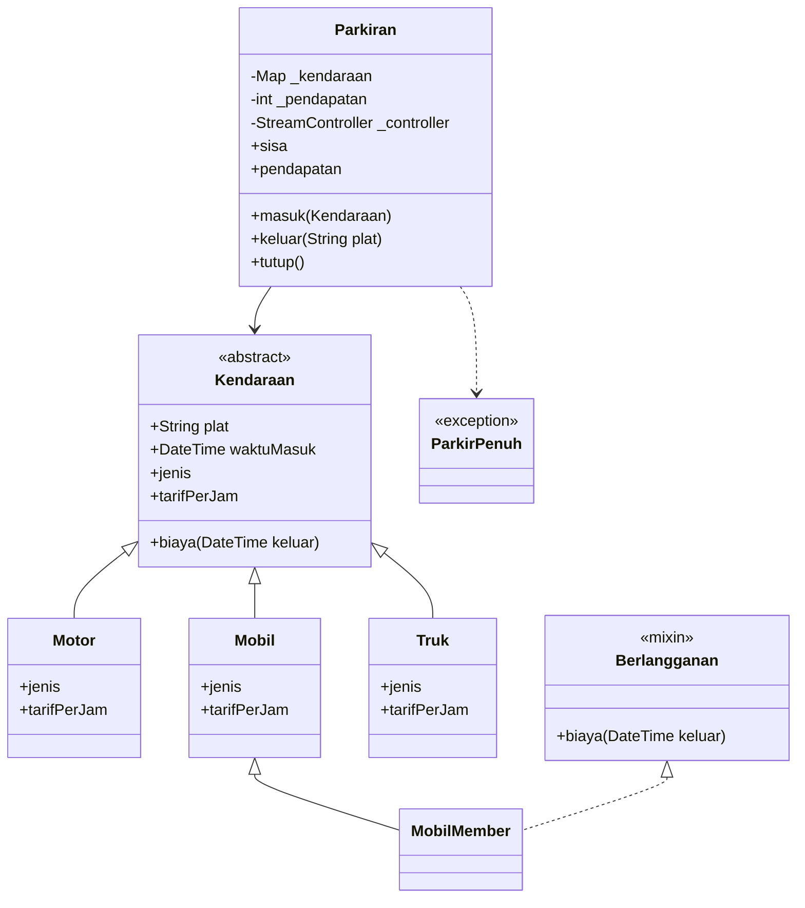
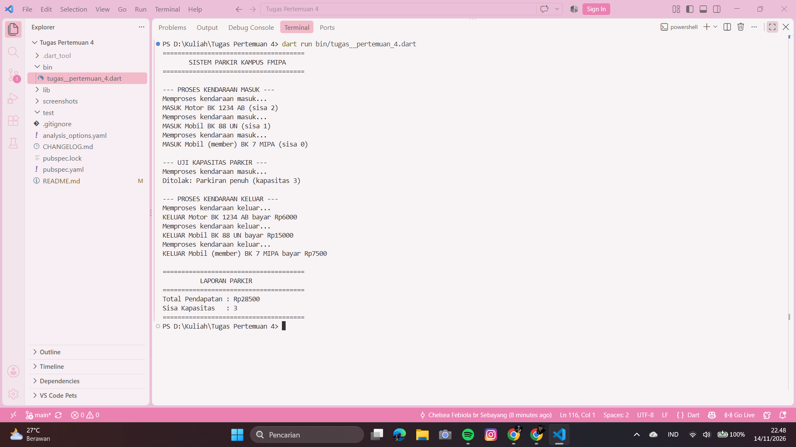

# Tugas Rutin 4 – Sistem Parkir Kampus FMIPA

## A. Identitas

## Identitas
- Nama: Chelsea Febiola br Sebayang
- NIM: 4243250015
- Mata Kuliah: Pemrograman Mobile
- Program Studi: Ilmu Komputer
- Tugas: Pertemuan 4

## B. Deskripsi Program

Sistem Parkir Kampus FMIPA merupakan aplikasi berbasis console menggunakan bahasa pemrograman Dart. Program ini digunakan untuk menyimulasikan proses kendaraan masuk dan keluar area parkir, menghitung biaya parkir berdasarkan jenis kendaraan, menerapkan diskon untuk anggota, serta menampilkan aktivitas parkir melalui Stream.

Jenis kendaraan yang digunakan adalah Motor, Mobil, dan Truk. Kapasitas parkir dalam simulasi ini adalah 3 kendaraan.

## C. Diagram Kelas

## D. Tangkapan Layar Keluaran Program

Simpan tangkapan layar hasil program pada folder `screenshots` dengan nama `output.png`.

## E. Penjelasan Penerapan Konsep OOP dan Asynchronous

Program Sistem Parkir Kampus menerapkan konsep enkapsulasi dengan menggunakan atribut `_kendaraan` dan `_pendapatan` pada class Parkiran. Kedua atribut tersebut dibuat bersifat privat sehingga tidak dapat diakses secara langsung dari luar class. Untuk mengakses informasi, digunakan getter seperti `sisa` dan `pendapatan`.

Konsep polimorfisme diterapkan melalui abstract class Kendaraan yang diwariskan oleh class Motor, Mobil, dan Truk. Setiap class memiliki jenis dan tarif per jam yang berbeda. Selain itu, class MobilMember menggunakan mixin Berlangganan untuk memberikan diskon biaya parkir sebesar 50%.

Konsep asynchronous diterapkan menggunakan Future dan async/await pada metode masuk dan keluar. Future.delayed digunakan untuk menyimulasikan proses palang parkir. StreamController.broadcast() digunakan untuk mengirimkan informasi aktivitas kendaraan masuk dan keluar kepada listener secara langsung.

## F. Pernyataan Penggunaan AI

Dalam pengerjaan tugas ini, saya menggunakan ChatGPT sebagai alat bantu untuk memahami konsep pemrograman Dart, menyusun struktur program, memperbaiki kesalahan kode, dan menyusun dokumentasi README.md. Saya tetap mempelajari, menjalankan, dan memeriksa hasil program secara mandiri.
